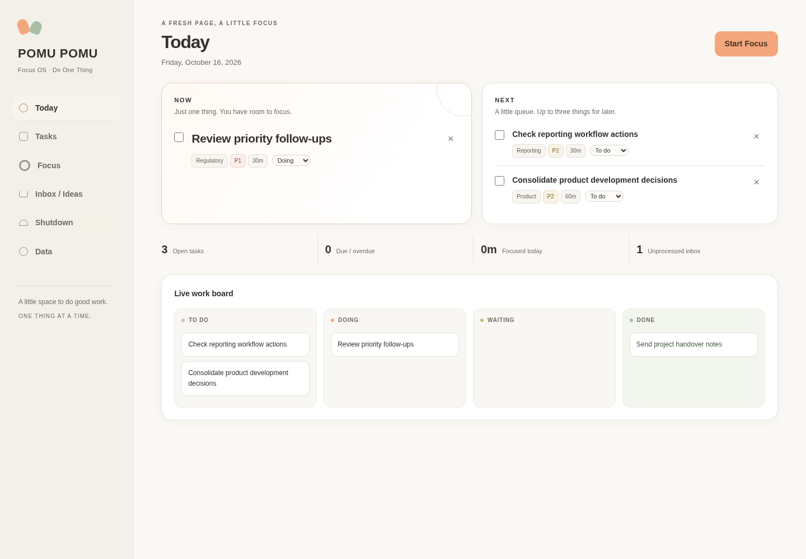
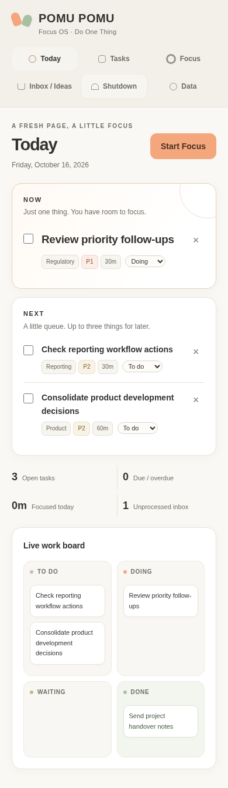
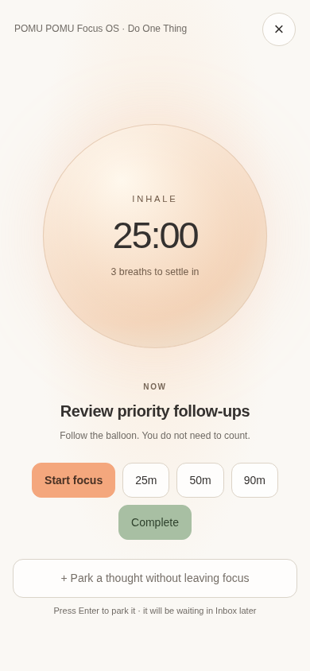

# V1.2 — Visual Foundation

The existing local-first application now uses a warm, light palette: paper `#FAF8F4`, peach `#F4A77D`, sage `#A8BFA3`, charcoal `#34312F`, and white cards. System fonts, rounded controls, light borders, and subtle shadows keep it calm and readable without external assets or dependencies.

Today begins at the top of the workspace. NOW and NEXT precede the smaller statistics, with Start Focus beside the heading and the complete work board below. The sidebar keeps all six destinations; on narrow screens it becomes a wrapping navigation grid. The focus overlay follows the same palette and retains the existing breathing sequence. Reduced-motion preferences disable orb scaling and transitions. Decorative shapes are CSS only; there is no mascot.

Application JavaScript, event handlers, element IDs, localStorage keys, and JSON data format are unchanged. Existing task editing consists of workflow status and completion controls; this redesign does not add a new editor.

## Review screenshots

Screenshots use representative test data, not a user's browser data.

### Desktop — 1440px

### Mobile — 390px

## Verification

Verified in headless Chromium with the environment's existing Playwright installation. No project dependency was added. Mobile and tablet checks use browser viewport emulation, not physical devices.

| Check | Result |
| --- | --- |
| Navigation: Today, Tasks, Focus, Inbox / Ideas, Shutdown, Data | Passed at 1440, 1024, 768, 390, and 320px |
| Horizontal overflow and navigation visibility | Passed on all six pages at every tested width; focus overlay also checked at 1440 and 390px |
| Task creation | Title, project, priority, estimate, and due date saved correctly |
| Existing task editing | Status changes, complete/reopen, and reload persistence passed |
| Timer | 25/50/90-minute selection, countdown, start, pause, resume, reset, and switching while running passed on desktop and mobile |
| Timer data preservation | Tasks, focus history, inbox, parked thoughts, anchor, and unrelated localStorage key unchanged |
| JSON backup | Native export download, import, and reload round trip passed; task content compared independently of the existing automatic sort order |
| Other workflows | Inbox capture and shutdown anchor saving passed |
| Reduced motion | Orb scaling disabled when requested |
| Text contrast | Main 12.17:1, secondary 5.28:1, peach action 6.10:1, sage action 5.49:1, placeholder 4.82:1 |
| Browser errors | No console errors or uncaught JavaScript errors in exercised workflows |
| Static checks | Application script byte-for-byte identical to main; all original IDs and event handlers retained; `git diff --check` passed |

Timer checks use simulated browser time; they do not wait for full 25/50/90-minute sessions. The prior timer fix is retained from main.
